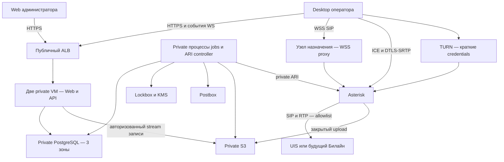

# ARCH-01 — размещение SashaTel
**Уточнение от 18.11.2026.** Направление принято для проработки, YC остаётся кандидатом до capacity/plan review. Создание ресурсов не разрешено. Новые решения и нециклические этапы описаны в [ARCH-01-v2](ARCH-01-v2.md), реализации IaC посвящён отдельный DEPLOY-01a Draft PR от main `fff308d7156d52bc3fcecdb024863f0b471679bd`. Цифры и статусы исходного аудита ниже — срез 17.11, не runtime evidence на 18.11.

Срез 17.11.2026. Статус — предложение для review. Платные ресурсы, DNS и действующий VPS в рамках ARCH-01 не менялись. Выбор облака, SLO и объёмы требуют утверждения. [Матрица доказательств](ARCH-01-evidence.md), [ресурсы и задачи](ARCH-01-delivery.md).

## Рекомендация

Предлагаю Yandex Cloud, регион Россия, с Web/API на двух VM, отдельными процессами фоновых обработчиков, управляемой PostgreSQL в трёх разных зонах, приватным S3, Postbox и Lockbox/KMS. Asterisk и TURN размещаются на отдельных VM со статическими адресами и явным назначением узла Backend. Стартовая топология рассчитана на измеряемый небольшой коммерческий пилот, с теми же границами при росте. Приложение остаётся модульным монолитом с отдельными процессами для разной нагрузки и привилегий. Очередь задач — PostgreSQL outbox, пока её нагрузка подтверждённо укладывается в БД. Kubernetes, Kafka, отдельный Redis и шардирование сейчас не решают доказанного ограничения.

Выбор основан на сочетании managed PostgreSQL/PITR, управляемого HTTP ingress, секретов и транзакционной почты в одном российском контуре. **Условие перед закупкой** — письменное подтверждение доступной ёмкости в трёх независимых зонах и текущей работоспособности выбранных сервисов, затем короткая сетевая квалификация SIP/RTP и доступа пользователей. Оплаченный Timeweb остаётся инженерным стендом до отдельного решения о выводе. Исправление его UDP-маршрута продолжается независимо от Web/Auth/DB.

У YC был существенный октябрьский инфраструктурный инцидент. По официальному сообщению от 10.11 восстановлено 97,16% данных, часть данных без бэкапов потеряна. Новая зона f вводится с ограничениями квот и части сервисов. Это увеличивает риск ёмкости и коррелированного отказа. Поэтому резервирование в другой российской площадке и доказательство восстановления входят в базовый план. Если три зоны/DB/S3/ALB недоступны в нужном сочетании, закупка приостанавливается и ADR пересматривается в пользу Selectel после эквивалентного capacity review. [Официальное сообщение YC](https://yandex.cloud/ru/blog/recovery)

## Сравнение облаков

| Вариант | Подтверждено документацией | Оценка для SashaTel и обязательная проверка |
| --- | --- | --- |
| Yandex Cloud Россия | PostgreSQL с репликами по зонам, PITR, ALB, S3, Lockbox, Postbox | Выбран как интегрированный стек. Текущие квоты/зоны и последствия инцидента проверить до заказа. SIP не пропускать через HTTP ALB. |
| Selectel Россия | Managed PostgreSQL с синхронной репликой и Multi-AZ размещением в ru-6, PITR, S3, балансировщик и secrets manager | Полноценная альтернатива. Уточнить доступную конфигурацию/версию PostgreSQL, независимость ДЦ, цену, mail provider и сетевые маршруты до UIS. Наличие трёх реплик в одном ДЦ не даёт отказоустойчивости к потере площадки. |
| Timeweb Cloud | Managed PostgreSQL с репликацией, физические бэкапы по расписанию и экспорт, S3 | Существующий VPS удобен для инженерного расследования. В просмотренных материалах не установлены точные PITR window/lag и независимость размещения реплик. Открытый кейс UDP требует решения или проверенного альтернативного узла. Эти пробелы требуют подтверждения, а не вывода об отсутствии возможностей. |

Источники сравнения — [YC HA](https://yandex.cloud/ru/docs/managed-postgresql/concepts/high-availability), [YC backup](https://yandex.cloud/ru/docs/managed-postgresql/concepts/backup), [Selectel fault tolerance](https://docs.selectel.ru/en/managed-databases/postgresql/cluster-fault-tolerance/), [Selectel backup](https://docs.selectel.ru/managed-databases/postgresql/backups/), [Selectel LB](https://docs.selectel.ru/cloud-servers/load-balancers/about-load-balancers/), [Timeweb PostgreSQL](https://timeweb.cloud/services/postgresql), [Timeweb backup](https://timeweb.cloud/docs/dbaas/dbaas-manage/backup).

Предполагаем основной рынок РФ из продуктовой модели ИНН/DaData и договоров связи. Фактическую географию нагрузки ещё требуется измерить. Тестировать HTTPS/WSS/UDP/TURN из фиксированных и мобильных сетей РФ, отдельно из регионов клиентов. Российское размещение упрощает операционную работу и доступность сервисов для местных пользователей, но не гарантирует доступность каждого маршрута и юридическое соответствие. Перед клиентскими данными юрист подтверждает роли оператора/обработчика, согласия и основания записи, локализацию, трансграничную передачу для AI/CRM/email, retention/удаление, договоры с облаком и оператором. Аттестат облака покрывает лишь часть обязанностей клиента. [Раздел ответственности YC](https://yandex.cloud/ru/security/standards/152-fz)

## Компоненты и доверенные границы

Предлагаемые DNS имена app/api/media-N/turn-N — логические, создание записей отложено. Web и API обслуживаются одним origin platform.sashatel.ru, API по /v1, чтобы Web cookie/CSRF проще контролировать. Desktop использует тот же origin platform.sashatel.ru. ALB принимает 443, WebSocket Upgrade настроен явно; HTTP redirect на HTTPS. На двух private app VM одна сборка Web плюс API с раздельными systemd/containers и health endpoints. Текущий loopback listener Backend менять только в DEPLOY-01 или оставить за локальным reverse proxy на app VM. Заголовки forwarded доверять только ALB, удалять поступившие клиентские значения. Текущий rate limiter по remoteAddress иначе ограничит всех пользователей адресом proxy.

Jobs запускаются двумя процессами на отдельных private VM; claim/lease/fencing и outbox в PostgreSQL. Роли dispatch, provisioning, email и recording upload разделены в коде и IAM. Сервис API не получает права SSH/root на PBX. ARI controller имеет только private сетевой доступ к телефонным узлам. Privileged локальный provisioner принимает подписанную/аутентифицированную команду доверенного control plane через ограниченный агент, без произвольных shell/path/dialplan из API. Пока transport adapter и multi-scope нет, путь клиентов закрыт.

Публично доступны только ALB 443, WSS 443 назначенных media узлов, TURN 3478 UDP/TCP и 5349 TLS (при необходимости отдельный TURN TLS 443 на выделенном IP), ICE RTP диапазон Asterisk и ограниченный TURN relay range. Конкретные диапазоны фиксировать по ёмкости и firewall review. Выделить RTP 10000–19999/UDP и TURN relay 20000–39999/UDP как проектные диапазоны, проверить расход портов на тесте. WebRTC медиапакеты могут приходить из произвольных пользовательских NAT, поэтому здесь нужны публичные media порты, strict RTP/ICE authentication, DTLS и rate limits. На провайдерском SIP transport только подтверждённые SBC CIDR/порты; RTP от provider по согласованным сетям. ARI/AMI, DB 6432 (managed pool), SSH, метрики и internal health не публиковать. Клиентам VPN не нужен; административный VPN/bastion доступен ограниченным инженерам.

## Аккаунт и данные

Один глобальный аккаунт email/password, подтверждение кода и password reset. Новая организация неверифицирована, все её транки выключены по умолчанию. Activation транка и новые вызовы требуют verification, затем повторного Backend gate. Членство в организациях отдельно. Web cookie HttpOnly/Secure/SameSite с CSRF, Desktop refresh в OS key store и main process. Сессии и их revoke/rotation лежат в БД. Локальная память API не определяет авторизацию. Email-code хешируется, TTL/одноразовость/ограничения попыток атомарны. Отправка через durable job, повтор не создаёт новый аккаунт. DaData вызывается из Backend с таймаутами и ограничением квоты, ключ в Lockbox. При недоступности сохраняется незавершённый шаг без фиктивных реквизитов.

S3 содержит закрытые записи, экспорты и отдельные backup buckets с разными service accounts. Имя объекта tenant/call/opaque ID помогает управлению, но права проверяет Backend по БД. Авторизованное проигрывание через API proxy с Range, перепроверкой membership и аудитом. Краткая presigned ссылка допустима как опциональное решение с утверждённым окном отзыва; для строгого немедленного revoke использовать proxy. Не журналировать URL подписи. TLS, encryption at rest, KMS keys и least privilege обязательны.

Запись формируется на media узле с привязкой call_id, node_id, epoch и всех legs. Закрытые чанки выгружаются с checksum и идемпотентным object key. Объект становится available только после проверки upload и DB manifest. При недоступном S3 локальный зашифрованный spool и durable очередь, очистка после подтверждения и периода восстановления. Предлагаю chunks 30 секунд, тест аварийного завершения записи и сигнал missing/partial. При заполнении spool новые вызовы с обязательной записью блокируются, существующие получают честный recording failure. Решение о продолжении разговора при потере записи должен утвердить продукт/юрист. AI обработка асинхронная после upload с отдельным статусом, location/provider требует проверки до отправки ПДн.

## PostgreSQL, версии и пул

Предлагаю Node 24 LTS с фиксацией patch/digest в релизе. Официальный актуальный просмотренный релиз — 24.22.3 от 11.11.2026. Backend уже требует >=24 и запускает TS напрямую. TS typecheck сохраняется, Electron runtime рассматривается отдельно. [Node release](https://nodejs.org/en/blog/release/v24.22.3)

Сохраняем PostgreSQL. Для первого managed deploy предлагаю 17 с актуальным доступным security minor, чтобы совпасть с CI #14; 18 допустим после матрицы тестов и managed-service review. YC поддерживает 17/18. Официальные страницы PostgreSQL дают разный по свежести patch snapshot, release notes уже перечисляют 17.12/18.7, поэтому перед фиксацией получить доступный service patch и записать SELECT version() в evidence. [YC версии](https://yandex.cloud/ru/docs/managed-postgresql/), [PostgreSQL release notes](https://www.postgresql.org/docs/release/)

Runtime роль NOSUPERUSER/NOBYPASSRLS/NOCREATEROLE/NOCREATEDB не владеет таблицами, не может SET ROLE в owner. Migration role отдельная, используется только сериализованным deploy job. SECURITY DEFINER только минимально необходимые функции с фиксированным search_path и ревью. FORCE RLS нужен всем tenant-таблицам, плюс составные FK с organization_id. Глобальные users/roles и общий физический Caller ID counter имеют отдельную модель доступа. В #14 глобальный counter number_attempts не RLS, users глобальны — ограничить grants и SQL поверхности, чтобы нельзя было читать чужие учётки и счётчики через новый API. Tenant setting сам по себе не аутентификация, Backend выводит его из проверенной сессии. Superuser/BYPASSRLS обходят RLS даже при FORCE. [PostgreSQL RLS](https://www.postgresql.org/docs/current/ddl-rowsecurity.html)

Для tenant SQL использовать BEGIN → SET LOCAL/set_config(...,true) → запросы → COMMIT на одном checkout pg client. #14 уже так делает. На API pg.Pool max 10 на процесс, на два jobs процесса max 5, итого начальный бюджет 30 прикладных соединений плюс 10 резерв для обслуживания. Значения проверить нагрузкой и лимитом выбранного класса. Managed Odyssey в transaction mode проверяем cross-tenant alternating test и rollback/error paths, без session-level GUC/locks/listen. Для migrations и отдельного LISTEN при необходимости — выделенный session connection. STATEMENT pooling не подходит многозапросным транзакциям. Connection lifetime/reconnect и повтор только идемпотентных транзакций при failover. Долгие WS не занимают DB client на всю жизнь сокета. [Odyssey](https://yandex.cloud/ru/docs/managed-postgresql/concepts/pooling)

## Телефония и рост

Desktop получает после авторизации короткоживущую tenant/session scoped WebRTC identity. SIP credentials провайдера и ARI остаются на сервере. WSS шифрует сигнализацию, DTLS-SRTP медиа, ICE выбирает путь, TURN имеет короткие привязанные к сессии credentials и квоты против open relay. Ограничить допустимые media hostname и expiry, проверить direct/relay/TCP/TLS из реальных сетей. WSS proxy публикует только SIP WebSocket path. HTTP ARI и admin routes не проходят через public virtual host; доверенные сертификаты и mTLS для внутренних control channels. Отзыв identity закрывает регистрацию и новые вызовы, поведение активных разговоров зависит от причины: просрочка/disable trunk блокируют только новые, security revoke может потребовать teardown по утверждённой политике. Коммерческий WSS не использует админский WireGuard. [Asterisk WebRTC](https://docs.asterisk.org/Configuration/WebRTC/Configuring-Asterisk-for-WebRTC-Clients/), [TURN RFC 8656](https://www.rfc-editor.org/info/rfc8656/)

API повторно проверяет право звонка, верификацию организации, разрешённые trunk/Caller ID, concurrency, состояние оплаты по утверждённой постоплатной модели. Пилотный INSUFFICIENT_BALANCE gate #14 не является принятой финансовой моделью. Backend согласует gate для постоплаты с опциональным кредитным лимитом без конкурирующей реализации DevOps. Лимит 8/сутки остаётся историческим техническим ограничением до сверки со спецификацией/оператором, не подменяет постоплату. Очередь dispatch атомарна и идемпотентна. SIP endpoint не имеет PSTN dialplan/REFER/redirect bypass. Только server-authorized ARI controller создаёт внешний leg из серверного mapping. Даже обладая краткой SIP identity, клиент может попасть только в закрытый ingress, где проверяется серверный attempt, session epoch и endpoint ownership.

Для двух PBX на старте предлагаю active/standby ownership **по trunk**, с принудительным fencing при переключении. Одновременную регистрацию одного UIS account с двух узлов не предполагать допустимой. Уточнить политику регистрации и fixed egress у UIS. В PostgreSQL trunk assignment хранит node_id/generation; call record — неизменяемые owner_node_id/owner_epoch/attempt_id/channel IDs/linkedid. Lease решает назначение новых вызовов, но при потере связи старый узел сам закрывает новые originate и egress. Прежде чем включить standby, изолировать старый узел через cloud/network fencing или доказать его остановку. Один TTL не предотвращает split-brain. Неопределённый originate не повторять автоматически.

Рост — несколько active PBX с разными trunk assignments и N+1 capacity, модули API/jobs масштабируются отдельно. Drain исключает узел из новых assignments, ждёт завершения всех legs и upload queue, затем provisioning/restart. При падении узла активный разговор обрывается; подтвердить итог через CEL/CDR/provider, пометить unknown/partial recording и не создавать новый звонок за пользователя. Re-registration даёт путь только новым звонкам. SIP proxy/SBC вводить при доказанной необходимости маршрутизации большого числа registrations или защите shared edge, после нагрузочного теста.

Текущий worker не готов к такому пулу. Он имеет фиксированные uis-smoke-* имена, один state root и active pointer, scope задаётся CLI, один системный unit и глобальный restart при нуле всех каналов. Разные каталоги не устраняют collision PJSIP IDs. Нет purge старых secret bundles; disabled не означает removal, а generic error не соответствует готовому wire API. Нужно versioned node manifest со всеми tenant/trunk, namespaced IDs, trusted scope mapping, peer ACL и security review, per-node single writer, hot reload только поддерживаемых объектов с проверкой; transport changes через node drain/restart. До этого допустим только изолированный single-trunk инженерный узел с ограниченным доступом.

## Модель нагрузки и пределы

Предположения для sizing, не прогноз продаж и не подтверждённая capacity.

| Сценарий | Аккаунты / DAU / пиковые logged-in | Попытки/день | CPS busy hour | Одновременные разговоры |
| --- | --- | --- | --- | --- |
| Первый продуктовый пилот | 1 000 / 100 / 50 | 2 000 | 0,11 при 20% попыток за час | ~11 занятых sessions при базовом профиле; проектный cap 20 |
| Рост | 100 000 / 10 000 / 5 000 | 200 000 | 11,1 | ~1 089 занятых sessions; два legs на разговор |
| Увеличение базы | 300 000 / 30 000 / 15 000 | 600 000 | 33,3 | ~3 267 занятых sessions |

Расчёт L=lambda × (0,4×(20s ringing+180s talk)+0,6×30s ringing)=lambda×98s. Получаем 11 / 1 089 / 3 267 занятых sessions. Затем добавить запас 30% и capacity для отказа крупнейшего узла. Каждая session занимает более одного channel leg. Не применять размер базы к числу каналов напрямую.

20 звонков G.711 с 20ms пакетами примерно 80–100 kbit/s на одно направление одного leg с overhead. Два legs дают ~4×100×20=8 Mbit/s суммарного RX+TX PBX. Opus/transcoding, TURN, recording и packet rate измеряются отдельно; CPU capacity не выводится из vCPU. Испытать 20, 40, 80 concurrent и CPS bursts на 4 vCPU/8 GB, G.711/Opus, RTP loss/jitter, DTLS и запись, с реальным двусторонним звуком. Рабочий cap — минимум CPU/network/spool/provider-channel/CPS и measured safe capacity с запасом. Для пула 1 100 calls число PBX=ceil(1 100/проверенный cap)+N+1 reserve, а не заранее обещанные 2 узла.

Пилот 2 000×40%×3min×22дня=52 800 разговорных минут/месяц. PCM 8kHz mono16 ~0,96 MB/min; две отдельные дорожки ~1,92 MB/min. Консервативно хранить 2 MB/min →105,6 GB ≈98,35 GiB/месяц без компрессии, 90 дней ~295 GiB primary плюс версии/retention и off-provider копия. Исходящий G.711 трафик двух legs около 3 MB/min →158,4 GB ≈147,5 GiB/месяц, TURN relay и прослушивание добавляют расход. Рост 100× требует пересчёта БД/трафика/записей, длительность хранения не утверждена.

## Доступность и восстановление

Рекомендованные исходные цели для review — API 99,9% успешных платформенных запросов/30дней и p95 <500ms без внешних поставщиков; авторизация call-intent p95 <1s; телефонная платформа принимает 99,5% валидных попыток при зарегистрированном исправном provider. Busy/no-answer не ошибка платформы, но provider failures считать отдельным SLI и показывать пользователю. Запись available p95 <60s после конца, p99 <5min, доля потерянных/partial отдельно. Ошибки внешних сервисов видим в end-to-end SLI, не скрываем исключениями внутренних SLO.

DB три хоста по разным AZ, primary + sync replica + дополнительная replica, network SSD и private endpoint. Авто-failover не обещает нулевой downtime, клиенты reconnect. Рекомендуемый RTO узла БД <=5min, RPO подтверждённых sync commits 0 для одиночного сбоя, с оговоркой деградированной репликации. Logical corruption — PITR RTO <=60min при исходном размере, RPO <=5min по фактической свежести WAL. Backup window/retention 30 дней, archive lag alarm. Эти цифры требуют fault drill, не SLA облака. [YC HA](https://yandex.cloud/ru/docs/managed-postgresql/concepts/high-availability)

Managed backup/PITR плюс отдельный ежедневный зашифрованный logical export и object copies на другом российском провайдере, отдельные credentials и delete protection. Предлагаю off-provider RPO <=24h, восстановление региона <=8h после репетиции, snapshots app VM не источник бизнес-данных. Для более строгого disaster RPO потребуется CDC/репликация и дополнительные затраты. PITR восстанавливает в новый кластер, нужны резерв квоты и доступ к ключам. [YC PITR](https://yandex.cloud/ru/docs/managed-postgresql/concepts/backup)

Restore drill до первого клиента и ежемесячно по операторскому плану — marker transactions, corruption time, restore в закрытую сеть без email/PSTN, сравнить tenant counts/FK/ledger и manifest записей, проверить FORCE RLS runtime role, выполнить auth/history smoke и разбор orphan objects. Зафиксировать фактический RTO/RPO и обновить SLO. KMS и recovery доступ восстановить независимо от приложения, аудит break-glass. S3 versioning и задержанное lifecycle deletion; юридический delete распространяется на версии и backup retention с документированным сроком.
