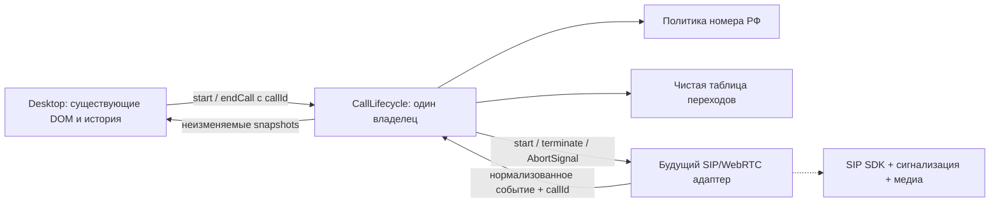

# Call Lifecycle Core — архитектура и интеграция

Документ фиксирует исходный результат PR #2. Расширение по Issue #4 — [Desktop owner / typed contracts / integration harness](core-desktop-contract.md); там актуальные команды, dev compiler и результаты расширенного набора тестов. Новое ядро по-прежнему не подключено к UI/SIP автоматически.

## Обследование опубликованного проекта

Основа работы — `feat/desktop-softphone-v1`, commit `139b121d9e05b0a4bb0b8f1e934f156fd4b7e544`. В `main` (`b1e5ae1`) только `index.html` и минимальный README. Поэтому PR ядра направлен в Desktop-ветку: изменения веб-прототипа не переносятся в `main` вместе с этой работой.

Веб-кабинет — автономный HTML/CSS/JavaScript-прототип с глобальным состоянием и данными-примерами. Desktop — Electron 45.3.2, Node.js 24 LTS, CommonJS main/preload и обычный JavaScript renderer, без React/TypeScript, сборщика, SIP SDK и автоматических тестов. Непубликованные изменения на Mac недоступны и не затронуты.

`desktop/renderer.js` содержит DOM, локальную демо-историю, `normalize`, `active`, `transition` и `interval` в одном файле. Демо-модель: отсутствие `active` → имитация набора → `answeredAt` через 1600 ms → завершение. SIP ringing, ошибки транспорта и подтверждение медиа отсутствуют. Это демонстрация, не телефонная сессия.

Повторно использовать можно разметку/стили, форматирование времени и отображение истории. Переносить демо-таймер соединения, `Date.now()` для длительности и нормализацию через удаление всех нецифр в новое ядро нельзя. UI, дизайн-система, Electron main, preload, Desktop package.json и веб-кабинет не изменены.

## Разделение ответственности



Модуль `packages/call-lifecycle` — ES modules, совместим с renderer без Node integration и с Node через `import()`. Нет Python-сервиса, сети, Electron API, DOM, звука, секретов или зависимости от SDK. Тестовый управляемый транспорт находится только в `test/`.

`state-machine.js` определяет все допустимые рёбра; `nextState` возвращает `null` для запрещённого события. `call-lifecycle.js` владеет эффектами, идентификатором, lease, AbortController и дедлайнами. `phone-number.js` реализует RU-политику. `transport.js` содержит JSDoc-контракт и безопасный разбор событий границы.

## Формальная модель

Ниже перечислены **все** рёбра. Любая другая пара состояние/событие, включая повтор `connected`/`ringing`, запрещена. Запрещённое транспортное событие игнорируется без эффектов. API не позволяет внешнему потребителю отправить `start`, `cleanup-*` или timeout как транспортное событие.

| Из состояния | События | В состояние |
| --- | --- | --- |
| idle | start | connecting |
| connecting | ringing | ringing |
| connecting, ringing | connected | active |
| connecting, ringing | cancel, rejected, no-answer, remote-ended, transport-error, connection-lost | terminating |
| connecting | setup-timeout | terminating |
| ringing | ring-timeout | terminating |
| active | hangup, remote-ended, transport-error, connection-lost | terminating |
| terminating | cleanup-ended | ended |
| terminating | cleanup-failed, termination-timeout, termination-error | failed |
| ended, failed | start | connecting |
| ended, failed | reset | idle |

`start` дополнительно требует свободного lease и не-disposed владельца; `reset` требует подтверждённой очистки **собственного** вызова. Это проверяемые guards поверх таблицы. Нового вызова не бывает в `terminating` или при неподтверждённой очистке, даже если состояние уже `failed`. Неверный номер возвращает ошибку команды без создания вызова и без перехода из текущего состояния.

`endCall(callId)` выбирает `cancel` до соединения, `hangup` после него. `remote-ended` до ответа означает `no-answer`, после — `remote-hangup`. Отмена, локальное/удалённое завершение активного вызова и dispose дают `ended` после очистки. Отклонение, отсутствие ответа, дедлайны и сетевые ошибки дают `failed` после очистки. Ошибка/тайм-аут самой очистки дают `failed` с причиной `termination-error`/`termination-timeout`, переопределяющей исходный исход.

Окончательное состояние публикуется только после очистки либо её дедлайна. Позднее успешное завершение очистки после тайм-аута меняет только `canStart`: исход, причина, время завершения и длительность терминального вызова сохраняются.

## Гарантии и время

* Lease резервируется синхронно **до** асинхронного `transport.start`; двойной click/Enter и несколько владельцев из одного импорта не запускают параллельные попытки. Вызовы получают `realm UUID : возрастающий bigint`, ID не переиспользуется при reset или быстрых повторах.
* Каждый callback замыкает конкретную попытку; принимаются только её `callId`, ссылка на текущую попытку и разрешённое для текущего состояния событие. Команда завершения тоже требует `callId`.
* Весь путь завершения один: переход в `terminating`, фиксация длительности, отмена setup, один вызов `terminate`. Дубли ничего не делают. `start`/`terminate` могут синхронно выбросить исключение или асинхронно отклониться: оба пути обработаны, произвольные сообщения ошибки не попадают в snapshot.
* По умолчанию connecting имеет 15 s, ringing — 45 s от первого ringing, terminating — 5 s. Подтверждённое соединение отменяет дедлайны набора; повторные provisional-события не продлевают ringing. На любой выход из live-фаз setup AbortSignal отменяется. Дедлайн завершения отменяет ожидание remote cleanup через отдельный сигнал. Отменённые callbacks дополнительно проверяют попытку/состояние, даже если уже попали в очередь.
* `performance.now()` — монотонные относительные миллисекунды; `connectedAt === 0` корректно. До `connected` длительность строго нулевая. В active она вычисляется при `getSnapshot()`, в terminating/terminal заморожена на момент остановки. **Нет внутреннего интервального таймера** и нет отсчёта от отправки INVITE. Время cleanup не входит в разговор. Это клиентская оценка, не биллинг/CDR.
* `subscribe` получает замороженные значения в порядке переходов, без начального callback; первый snapshot нужно прочитать явно. Ошибка наблюдателя не ломает эффекты. Реентерабельные команды из наблюдателей ставят уведомления в очередь. Изменение длительности само по себе не генерирует уведомления.
* `dispose()` идемпотентен, запрещает новые команды start/reset, удаляет подписчиков и запускает/дожидается уже запущенной ограниченной по времени очистки. Он не снимает небезопасный lease.

### Почему тайм-аут не освобождает слот

Если `terminate` завис/отклонился, ядро не знает, уничтожена ли сессия. Поэтому состояние `failed` не означает `canStart=true`. При зависании lease освобождается только после реального позднего resolve **того же** terminate. После reject автоматического восстановления нет; нужен подтверждённый полный teardown владельца транспорта/клиентского процесса. Создание нового `CallLifecycle` из того же модуля не обходит блокировку.

Это намеренный выбор надёжности вместо автоматического redial при неопределённой сессии. Повторных попыток terminate, сетевых retry и скрытого auto-dial нет.

## Контракт будущего адаптера

Точные типы находятся в [transport.js](../packages/call-lifecycle/src/transport.js). Адаптер обязателен; SDK-реализации и фабрики «успешного звонка» здесь нет.

```js
// Сигнатуры; это не реализация транспорта.
start({ callId, number, signal, emit })        // void | Promise<void>
terminate({ callId, reason, signal })          // void | Promise<void>
emit({ callId, type })                        // boolean: принято / проигнорировано
```

1. `start` привязывает application ID к конкретной SDK-сессии, регистрирует слушателей до отправки INVITE и учитывает уже отменённый сигнал. Resolve означает лишь завершение отправки/подготовки, **не** ответ собеседника. Асинхронная подготовка медиа после abort не должна отправлять INVITE.
2. `connected` допустим только после подтверждённого диалога **и** готовности медиа по выбранному SDK. SIP 100/180/183, early media, открытие WebSocket или resolve start не подтверждают разговор.
3. `terminate` безопасен до вызова start, во время pending start и после любого исхода, включая сетевую ошибку. Он должен немедленно установить fence для ID, отменить подготовку и исключить последующее origination. Он сам выбирает CANCEL до ответа / BYE после ответа, отписывает SDK listeners и освобождает tracks, media и ресурсы сессии.
4. Поздний SIP 2xx после CANCEL обрабатывается **в адаптере** (ACK и BYE), даже если ядро игнорирует поздний `connected`. Игнорирование состояния в ядре не является очисткой SIP-диалога.
5. Сигнал terminate ограничивает ожидание удалённого завершения; abort не оправдывает пропуск локального cleanup. Resolve разрешён только когда эта попытка больше не может породить/возобновить локальную сессию. Если это невозможно подтвердить — reject, ядро останется fail-closed. Адаптер обязан быть корректным; ядро не может физически остановить стороннюю библиотеку, игнорирующую сигнал.
6. Сырые SIP/SDK события сначала отображаются в whitelist ниже. Unknown/некорректные данные, в том числе getters, не выбрасывают исключений в ядро. Неизвестный код нельзя считать успехом.

| Нормализованный тип | Значение для адаптера |
| --- | --- |
| ringing | Подтверждённое оповещение абонента; 183 самостоятельно не подтверждает ответ |
| connected | Подтверждены диалог и usable media |
| rejected | Отклонение/занято до соединения, например 486/603 |
| no-answer | Истёк удалённый период ожидания до соединения, например применимый 408/480 |
| remote-ended | Конкретная сессия завершена удалённой стороной |
| transport-error | Ошибка отправки, SDK, регистрации или подготовки медиа этой попытки |
| connection-lost | Утрата сигнализации/медиа, которую политика SDK сочла окончательной |

Соответствие SIP-кодов зависит от SDK/оператора: таблица не заменяет SIP implementation. Transient ICE disconnected нельзя без выбранной политики восстановления автоматически считать окончательной потерей связи. Raw payloads, credentials и тексты серверных ошибок в контракт не передаются.

## Политика номеров

`normalizeRussianNumber(unknown)` возвращает `{ok:true,number,country:'RU'}` или `{ok:false,error}`. Поддерживает 11 цифр с `7`/`8`, `+7`, а также прежний Desktop-ввод из 10 национальных цифр. Результат — E.164 `+7XXXXXXXXXX`.

Разрешены пробелы, NBSP/узкий NBSP, точки, дефисы, скобки и clipboard tab/CR/LF. ASCII-цифры обязательны. Текст, emoji, bidi/zero-width, Unicode-цифры, расширения, tel: URI, лишний/внутренний плюс и другие страны отклоняются, а не очищаются до возможного чужого номера. Проверка длины 128 UTF-16 units выполняется до trim/replace; более 11 цифр не допускается. Неполный номер не дополняется. Функция не хранит буфер: повторное удаление не возвращает старый номер.

Национальные коды начинаются с 3/4/8/9: RU geographic, service, mobile. Казахстанские +7 6xx/7xx исключены. Проверка синтаксиса не подтверждает выделение/доступность номера, стоимость маршрута или принадлежность абонента. Десятизначный ввод имеет явную национальную семантику; полная адресация с `+7` предпочтительна для вставки.

`options.normalizeNumber` позволяет позднее подключить международную политику без изменения FSM. Ядро дополнительно проверяет E.164 (до 15 цифр) и однократно фиксирует поля результата политики внутри try/catch. Это программная точка расширения, не IPC-параметр пользователя.

## Интеграция с существующим Desktop

1. Сначала отдельно реализовать и протестировать настоящий адаптер по контракту. До этого текущий Desktop остаётся **DEMO**: добавление пакета не подключает телефонию. Не использовать демо-переход через 1600 ms как источник `connected`.
2. При согласованной интеграции перевести renderer entrypoint в ES module (`type="module"`), создать **одного** владельца на всё клиентское приложение и импортировать API относительным путём. Сборщик и Node integration не нужны. Для будущей упаковки включить `packages/call-lifecycle/src` рядом с `desktop` в app resources; при иной структуре скорректировать import.

```js
// Пример будущего renderer-controller; сейчас в UI НЕ подключён.
import { CallLifecycle } from '../packages/call-lifecycle/src/index.js';

// adapter передаётся из слоя настоящей SIP/WebRTC интеграции.
function createController(adapter, renderSnapshot, recordTerminalOnce) {
  const core = new CallLifecycle(adapter);
  let previous = core.getSnapshot();
  renderSnapshot(previous);
  const unsubscribe = core.subscribe(snapshot => {
    renderSnapshot(snapshot);
    // Позднее снятие quarantine тоже публикует snapshot терминального состояния.
    if (['ended', 'failed'].includes(snapshot.state) &&
        (previous.callId !== snapshot.callId || previous.state !== snapshot.state)) {
      recordTerminalOnce(snapshot); // Хранилище также должно быть idempotent по callId.
    }
    previous = snapshot;
  });
  return {
    start: raw => core.start(raw),
    // Сохранять ID, показанный конкретной кнопкой/командой, а не брать новый при доставке IPC.
    end: callId => core.endCall(callId),
    snapshot: () => core.getSnapshot(),
    close: () => { unsubscribe(); core.dispose(); },
  };
}
```

3. Оставить существующие DOM/стили/дизайн. Заменить только демо-controller и локальную нормализацию на команды ядра; состояние кнопок берётся из snapshot, но окончательный guard остаётся в start. UI-таймер 250 ms может только читать `getSnapshot().durationMs`, не инициировать состояние. Остановить его при уходе с экрана/закрытии. Для истории сохранить отдельно wall-clock дату, поскольку timestamps ядра относительные. Клиентскую длительность не использовать для списаний.
4. В рамках будущей SIP-задачи потребуется согласованное изменение CSP (`connect-src 'none'` сейчас блокирует WSS) и permission policy (`main.cjs` отклоняет все permissions, включая микрофон). Делать allowlist конкретного транспорта и ограниченное разрешение нужного media origin, сохраняя sandbox/contextIsolation/nodeIntegration=false. В текущей задаче политики безопасности не ослаблены.
5. Несколько окон/Workers имеют разные JS realms. Все команды таких окон должны идти к **одному** владельцу через проверенный IPC, а не создавать по core в каждом окне. Lease этого модуля не является межпроцессным lock. Повторная загрузка разных копий пакета тоже недопустима. Для текущего одного Desktop-окна подходит renderer owner; будущий main/utility coordinator должен маршрутизировать команды к единственному media owner, сохраняя callId. Изменений main для поставки ядра не нужно.
6. Перед выпуском проверить реальный Electron flow на Windows/macOS: reload/window close, сон/пробуждение, микрофон, CSP, IPC, SDK listeners, late CANCEL/2xx, обрыв WSS и ICE. В облаке проверено ядро Node.js, а не работа SIP/GUI или установщиков.

## Проверки и обнаруженные дефекты

Node.js `v24.22.1`, Linux; зависимости и Electron не устанавливались. Команды из корня:

```bash
npm --prefix packages/call-lifecycle test
npm --prefix packages/call-lifecycle run test:coverage
npm --prefix packages/call-lifecycle run test:mutations
```

Результат финального запуска с разрешёнными локальными дочерними процессами: **198 тестов, 198 passed, 0 failed**, включая 7 × 21 сочетание состояния/события (допустимые и запрещённые), сценарии транспорта/команд, отмену, дубли, сетевые ошибки, dispose, время и валидацию. Покрытие src: **100% строк, 99.48% ветвей, 100% функций**. В package scripts установлены обязательные пороги 95/90/95. CI выполняет coverage и mutation-проверку на Node 24 без npm install.

Дополнительно проверены все **120 перестановок** пяти конкурирующих событий/команд по независимой модели первого исхода; **10 000** воспроизводимых стресс-шагов с четырьмя seed, pending promises и быстрым повторным набором; **5000** сгенерированных форматированных номеров с идемпотентностью нормализации и отказом для добавленного мусора. Используется небольшой deterministic generator вместо зависимости property-based framework; автоматического shrinking нет. Навсегда quarantined сценарии проверяются в отдельных локальных процессах, без test-only метода обхода lease.

Проверена чувствительность тестов: все **4/4** намеренных мутации обнаружены assertion-ошибками в временных копиях — удаление защиты от старых событий, двойного старта, отсчёт длительности до ответа, освобождение lease по timeout. Исходники при этом не изменяются. В ограниченном облачном sandbox для mutation runner понадобилось разрешение на локальные дочерние процессы Node; сеть не используется.

Обнаружено и устранено в новой реализации: повторное чтение getter-полей результата расширяемой политики номера могло выбросить исключение из start или заменить уже проверенный номер. Регрессионный тест сначала дал **197 passed / 1 failed**, затем поля были зафиксированы однократно в try/catch; повторная проверка дала 198/198. Также отдельные регрессии защищают timestamp/timer handle со значением 0, stale callback после смены фазы и запрет сброса длительности повторным connected.

Выявленные ограничения опубликованного демо закрыты **в новом модуле**, но старый UI/controller намеренно не переписан: удаление произвольного текста из номера, отсутствие callId/FSM/failure-path, имитация connected таймером и wall-clock длительность. Это не заявление, что неизменённый renderer уже использует исправления ядра.

## Оставшиеся риски

* Гарантия единственной попытки локальная, в одном каноническом импорте/JS realm. Crash/reload/несколько окон, другой клиент и оставшийся на стороне оператора orphan dialog требуют серверной координации и CDR reconciliation. Разрыв сети не доказывает завершение удалённого плеча.
* Неправильный адаптер может проигнорировать abort/fence или преждевременно resolve terminate; ядро не исправляет нарушения транспортного контракта. Timeout/reject cleanup намеренно снижает доступность до подтверждённой очистки/полного teardown.
* `getSnapshot().canStart` — advisory значение; источником истины остаётся результат start. При нескольких экземплярах core подписки одного не получают уведомления об освобождении lease другим: приложение должно использовать одного владельца.
* OS suspend откладывает JS timeout callbacks. Клиентские времена относительные и не являются биллингом. История, timestamps для аудита, persistence и telemetry — отдельный слой; snapshots содержат номер, его нельзя бездумно писать в логи.
* Нет SDK, WSS/ICE reconnect, microphone/UI/installer smoke test, SIP trunk, реальных звонков или внешнего Asterisk. Эти интеграционные проверки остаются отдельной задачей.
