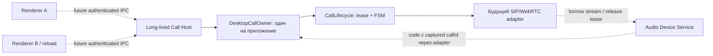

# Issue #4 — Desktop call owner и integration harness

Основание: [Issue #4](https://github.com/suprunmvp-web/sashatel/issues/4) и [Tech Lead review PR #2](https://github.com/suprunmvp-web/sashatel/pull/2#pullrequestreview-5911936502). База: `feat/call-lifecycle-core`, `1655e7eefda7d89271abe9a836ab9332ca1ff867`. Отдельная ветка: `feat/core-desktop-contract`; PR направлен только в `feat/call-lifecycle-core`.

Это исполняемый **in-process integration seam** и тестовый harness, не Electron IPC, SIP SDK или работающий телефон. Файлы UI, Audio, Electron main/preload, Backend и Asterisk не меняются. `CallLifecycle`, его таблица, нормализация и транспортные гарантии PR #2 сохранены.

## Один владелец и границы процессов



Хост создаёт единственный `DesktopCallOwner` и транспорт. Окна получают **порты**, а не конструкторы core, транспорт, AbortController, MediaStream или методы Audio. Публичный renderer API: asynchronous `request`, `getSnapshot`, `subscribe` — объявлен в `RendererCallAPI`. Исполняемый `RendererPort` синхронный, предназначен для host-side маршрутизации и deterministic tests. Electron glue намеренно не реализован в этой ветке.

Хост должен жить дольше видимых окон. Для WebRTC/Audio, требующих DOM, это отдельный стабильный media renderer/document; main координирует окна, но не получает DOM Audio или WebRTC автоматически. Существующий renderer-only Audio service нельзя просто переместить в main. Размещение long-lived host, загрузка service и authenticated IPC — интеграционная точка следующих задач, не изменение чужих файлов здесь.

`attachRenderer()` вызывается **только хостом** после проверки конкретного `webContents`, top frame, URL и поколения документа. Возвращённый capability не передаётся как произвольный sessionId. В реальном preload экспонируются только три узких метода, без generic send, invoke, attach, dispose, reportAudioIssue или emit. Для snapshot push валидируется адресат и поколение документа; при navigation/reload/crash/закрытии окна хост вызывает `port.disconnect()` и удаляет IPC listeners.

Отсоединение/перезагрузка окна не вызывает end/dispose, не сбрасывает lease и не создаёт нового владельца. Новая сессия начинает с getSnapshot/subscription существующего owner, видит текущий callId и quarantine. Закрытие последнего UI-окна тоже не доказывает окончания SIP. Только host shutdown вызывает `owner.dispose()`; новый владелец в том же JS realm не обходит lease core.

**Граница гарантии:** модульный lease не переживает падение call-host процесса и не является межпроцессным lock. После смерти host состояние считается неизвестным. UI блокирует start, не переносит состояние из localStorage и не пересылает старые start-команды новому host. Перед допуском нового host production bootstrap должен подтвердить полный teardown прежней сессии/выполнить серверную reconciliation. Такого bootstrap/backend recovery здесь нет. Новый `ownerId` fencing отклоняет команды старой эпохи, но сам по себе не доказывает отсутствие удалённого SIP-плеча.

## Типизированный wire contract v1

Источник типов: [index.d.ts](../packages/call-lifecycle/src/index.d.ts), runtime: [desktop-call-owner.js](../packages/call-lifecycle/src/desktop-call-owner.js). Типы проверяются настоящим TypeScript compiler (pinned 5.9.3) с положительными и отрицательными fixtures. Runtime-тесты отдельно проверяют форму, immutable ownership, structured clone и негативные сообщения. Декларации не заменяют runtime validation.

```ts
type RendererCommand = {
  protocolVersion: 1;
  ownerId: string;      // из handshake, не секрет и не средство аутентификации
  requestId: string;    // [A-Za-z0-9_-], 1..96 символов; уникален в renderer session
} & (
  { type: 'start'; number: string } |
  { type: 'end'; callId: string }
);
// Результат команды означает принятие, не ответ абонента/окончание SIP:
type CommandResult = { ok: true; callId: string } | { ok: false; error: UIError };
```

Прочие команды (`connected`, `emit`, `reset`, `force-unlock`, управление Audio) и лишние поля отклоняются. Номер — строка до 128 UTF-16 units, далее RU validation ядра; opaque callId до 256, ownerId до 128. Raw native errors, stack traces, SIP payloads и секреты не входят в response.

Snapshot содержит только cloneable данные:

| Поле | Семантика |
| --- | --- |
| protocolVersion: 1, ownerId | Версия и идентификатор жизненного цикла хоста |
| revision | Возрастает на lifecycle/audio update; после handshake принимать push той же эпохи только с более новой revision |
| safety | ready / occupied / cleanup-unconfirmed / closed |
| call | Все поля CallSnapshot PR #2: state, callId/number, relative startedAt/connectedAt/stoppedAt/endedAt, reason, durationMs, canStart, disposed |
| audioIssue | null или `{domain:'audio', callId, code}` — advisory для конкретного вызова |

`durationMs` меняется при чтении active snapshot, поэтому duration-only poll может иметь ту же revision. UI может применять такой **явно запрошенный** timer sample для той же эпохи/callId, не откатывая state. `subscribe` порта немедленно даёт текущий snapshot и затем упорядоченные revisions; подписчики, появившиеся во время обработки события, не получают старые queued snapshots. Внутри хоста snapshots frozen; structured clones в UI могут быть локально изменены без изменения источника.

### Ошибки UI

`UIError` — discriminated union `{domain,code}`. Локализованный текст задаёт UI по коду, не по сообщению native exception.

| Domain | Code | Действие потребителя |
| --- | --- | --- |
| call | INVALID_NUMBER | Исправить номер, использовать новый requestId |
| call | BUSY | Прочитать snapshot, не повторять автоматический набор |
| call | CLEANUP_UNCONFIRMED | Показать блокировку; ждать подтверждённого cleanup, не force-unlock |
| call | STALE_CALL | Старая кнопка/команда; получить snapshot, не подставлять новый callId автоматически |
| call | NOT_ACTIVE | Конкретная попытка уже не в live-фазе; повторный end без эффектов |
| protocol | INVALID_COMMAND / VERSION_MISMATCH | Отклонить сообщение; исправить клиент/версию |
| protocol | REQUEST_CONFLICT | Один requestId использован для разных команд/номеров; ошибка клиента |
| protocol | REQUEST_PENDING | Исходная команда реентерабельно ещё обрабатывается; повторить тот же requestId после её результата |
| owner | OWNER_CHANGED | Старая эпоха; новый handshake, никакого автоматического replay start |
| owner | SESSION_CLOSED | Старое поколение окна; перевыпустить authenticated session |
| owner | SESSION_EXHAUSTED | Бюджет replay journal исчерпан; хост перевыпускает session, затем getSnapshot |
| owner | OWNER_CLOSED | Хост остановлен; UI запрещает команды до подтверждённого восстановления |

Вызов renderer IPC может не вернуть response при потере канала — это connection failure bridge, **не** результат end и не разрешение набора. UI отображает owner unavailable и блокирует команды до handshake. Реальный transport-specific error handling bridge пока не реализован.

В каждой сессии journal хранит результат по requestId и fingerprint команды. Retry того же запроса возвращает тот же итог, даже после завершения вызова, не инициируя redial. Два разных requestId от double click всё равно защищены core lease. При reentrant processing ID уже зарезервирован, ответ REQUEST_PENDING не инициирует второй эффект. Устаревшие request IDs **не вытесняются**: после default 256 (настраивается 1..4096) новых запросов возвращается SESSION_EXHAUSTED. Host должен заранее/по этому ответу перевыпустить сессию, прочитать состояние и отправить end с **тем же callId**, если он всё ещё актуален. Это также применимо к end: ручка reconnect обязательна для production bridge. Disconnect удаляет bounded journal; resend старого start в новую сессию запрещён политикой UI. Host обязан ограничить число окон/сессий и всегда отзывать неиспользуемые.

### Код будущего renderer controller

```ts
// bridge: RendererCallAPI предоставит будущий узкий preload, не этот PR.
const initial = await bridge.getSnapshot();
if (!initial.ok) return showLocalizedError(initial.error);
const ownerId = initial.snapshot.ownerId;
// Для каждой новой user action сгенерировать requestId, для retry сохранить его.
const response = await bridge.request({
  protocolVersion: 1, ownerId, requestId: crypto.randomUUID(),
  type: 'start', number: rawInput,
});
// response.ok не означает connected. Состояние приходит из subscription.
```

Для end сохраняется callId, показанный конкретной кнопкой/командой. Нельзя при задержке IPC брать текущий новый ID. Новая страница всегда читает authoritative snapshot и не повторяет старый start автоматически.

## Стык Audio и SIP

Контракт сверён read-only с опубликованным Audio PR #3 (`feature/desktop-audio-foundation`): `acquireInput(): Promise<{stream,release}>`, ошибки `AudioDeviceError.code`, `attachPlayback(): Promise<detach>`. Не импортируем эту ветку и не меняем Audio. Совместимый union `AudioErrorCode` содержит опубликованные коды permission/device/interruption/timeout/cancellation и др.; это vocabulary, не вторая реализация Audio service. Следующие изменения Audio vocabulary требуют отдельного согласования контракта.

Адаптер захватывает callId/ownerId **при создании audio lease**, а не подставляет текущий ID при получении поздней ошибки. Хост маршрутизирует уже sanitized code через `reportAudioIssue({callId,code})`. Репортёр host-only, сам не останавливает медиа и SIP. Сырые сообщения, device IDs, labels и stream handles в snapshot не попадают.

* Audio acquire/test/permission success, meter или release не подтверждают SIP connected, BYE или cleanup. Audio loss/suspend/TCC denial не переводят active в ended и не снимают quarantine.
* Audio service владеет input stream/graph; SIP adapter заимствует lease и вызывает release в cleanup/finally. Remote tracks принадлежат SIP adapter; playback detach не означает remote SIP end.
* Политика SDK может при потере usable media сообщить `transport-error`/`connection-lost` или запросить end. В обоих случаях core проходит terminating, а terminate должен подтвердить fencing всех pending starts/медиа/сессии. Автоматическое восстановление/новый звонок из audio.resume запрещены.
* Реализация adapter должна уничтожить late acquireInput result после abort, даже если API Audio не принимает AbortSignal. Cleanup нельзя resolve до fencing/учёта таких pending operations; late stream не должен попасть в отменённый sender.

Поздний SIP 2xx после CANCEL: ACK и BYE — обязанность **адаптера**, даже когда core игнорирует ghost connected. Harness записывает только абстрактные `ACK-required` / `BYE-required`: не строит и не отправляет SIP пакеты, не подтверждает RFC-корректность реального SDK.

## Harness и проверки

[test/integration/harness.js](../packages/call-lifecycle/test/integration/harness.js) соединяет настоящий owner и core с виртуальными монотонными часами, clone boundary и управляемым FakeTransport. Отдельно управляются setup resolve, нормализованные события, abort, cleanup resolve/reject, late setup и stale events. Fake считает условные ресурсы и fencing; teardown каждого теста проверяет отсутствие pending core timers и условных ресурсов. Это проверка локальной логики, не физического audio/resource cleanup в браузере или SIP.

```bash
# Node.js 24 LTS, из корня. Только compiler dev dependency, без Electron/SIP.
npm --prefix packages/call-lifecycle ci --ignore-scripts --no-audit --no-fund
npm --prefix packages/call-lifecycle run test:integration
npm --prefix packages/call-lifecycle run test:contracts
npm --prefix packages/call-lifecycle run test:coverage
npm --prefix packages/call-lifecycle run test:mutations
```

CI запускает npm ci, contract compile, все unit/integration tests с прежними coverage thresholds и mutation checks. Добавлены негативные сценарии: два окна/2x click, late/ghost connected, terminate before start, CANCEL/2xx responsibilities, timeouts/rejected cleanup, reload в active/quarantine, stale commands/epochs, forbidden wire events, bounded replay, malformed/oversized input, observer exceptions/reentrancy, Audio issue correlation и невозможность считать Audio доказательством SIP end.

Финальная локальная проверка на Node.js 24.22.1/Linux: **215/215 tests passed**, из них **17 integration**, плюс успешный TypeScript compile с **9 отрицательными `@ts-expect-error`** контрактами. Покрытие src: **100% строк / 99.68% ветвей / 100% функций**; новый owner — 100/100/100. Все **7/7** mutation probes обнаружены assertion-ошибками: четыре инварианта PR #2, старая owner epoch, отозванный renderer и ложное завершение SIP при audio loss. Unit/integration tests не требуют npm install; compiler устанавливается из pinned lockfile. Дочерние процессы используются только локально для permanent-quarantine тестов и временных mutation-копий.

Фактически обнаружен и исправлен дефект нового owner: reentrant Audio report публиковал второму renderer revisions `0 → 2 → 1`. Сначала regression дал 13 passed / 1 failed; очередь уведомлений и per-listener revision fence исправили порядок. Отдельный тест защищает подписку, добавленную посреди публикации, от получения более старого queued snapshot. Другой путь обработки учитывает host dispose внутри number policy и возвращает OWNER_CLOSED вместо BUSY.

## Что остаётся для production

1. Реальные long-lived host/document и lifecycle при закрытии всех окон, упаковка модулей, authenticated/limited IPC и revocation frame generations. Текущий обычный renderer не становится host автоматически.
2. SDK-адаптер SIP/WebRTC с реальной регистрацией/сигнализацией/media readiness, CANCEL/late 2xx ACK/BYE и доказуемым cleanup; серверная reconciliation после process crash/сетевой неопределённости.
3. Подключение существующего Audio service к media owner, захват и корреляция lease ID, teardown late streams, осмысленная политика потери устройства. Облако не подтверждает физический Mac/USB/Bluetooth/TCC.
4. Интеграция существующего UI через типизированный bridge, локализация кодов, обработка reconnect/journal capacity/revisions и закрытия канала. Без изменения дизайна в этой ветке.
5. Отдельно reviewed CSP/WSS/ICE/microphone permissions, Electron E2E/security tests и smoke checks packaged macOS/Windows. Сейчас они не выполнены и безопасность IPC не заявляется проверенной.

Безусловного unlock API нет. Успешные tests говорят о локальной модели/контрактах; они не доказывают существование SIP, реальное аудио, безопасность будущего IPC или отсутствие remote orphan dialogs.
