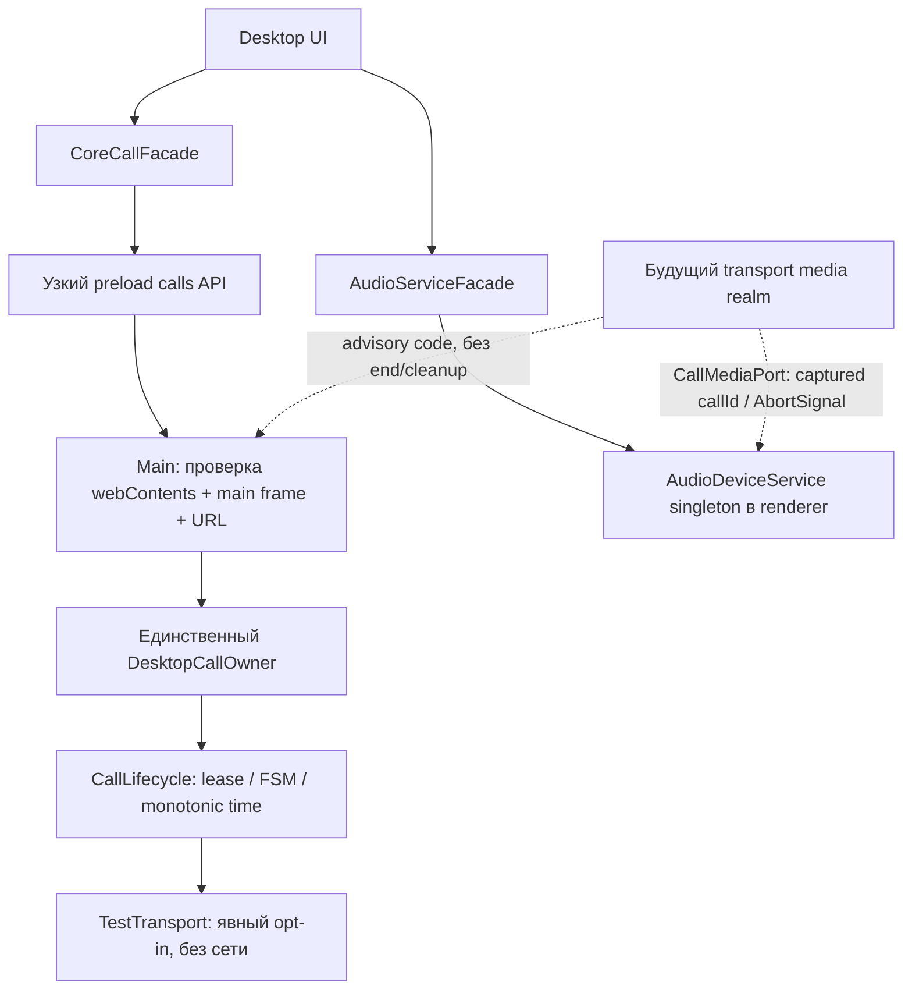

# SashaTel Desktop — интеграционная сборка (Issue #9)

Это Draft, не релиз и не SIP-телефон. База: `feat/desktop-softphone-v1` @ `139b121`. `main` и ветки авторов модулей не изменялись.

## Запуск

Требуется Node.js 24, npm и системные библиотеки Electron. Из корня:

```sh
npm --prefix desktop ci --ignore-scripts=false
npm --prefix desktop start
# Отдельный управляемый Demo/Test, только локальные тестовые номера:
SASHATEL_DEMO=1 npm --prefix desktop start
npm --prefix desktop run build
# Linux, обычный режим без транспорта:
./desktop/dist/SashaTel-linux-x64/SashaTel
# Linux, явный Demo/Test:
SASHATEL_DEMO=1 ./desktop/dist/SashaTel-linux-x64/SashaTel
```

В PowerShell переменная: `$env:SASHATEL_DEMO='1'`. В обычном режиме Audio/Settings работают, Call disabled; даже прямой bridge request возвращает `TRANSPORT_UNAVAILABLE`. Никакой регистрации Asterisk и автоматического ответа нет. «Ответ» в Demo/Test — явное синтетическое событие, не SIP.

Electron 45 npm-пакет больше не содержит собственного postinstall. Поэтому **проект** запускает `node node_modules/electron/install.js` в postinstall. Без этого `npm ci` устанавливал JS-пакет, но не запускаемый Electron — обнаружено при чистой установке. В Cloud с HTTP proxy нужен `NODE_USE_ENV_PROXY=1` для install/build (Node 24 fetch); TLS-проверка не отключается. На обычной машине без proxy эта переменная не нужна.

## Что интегрировано

| Компонент | Фактический путь | Статус |
| --- | --- | --- |
| UI → Core | `CoreCallFacade` → preload `calls` → authenticated main IPC → `DesktopCallOwner` → `CallLifecycle` | Реальный owner/Core, без отдельной UI FSM |
| UI → Audio | статический import bootstrap **до** composition root → singleton `AudioDeviceService` → `AudioServiceFacade` | Реальные enumeration, selection, PCM meter, gain/service API, generated tone, cleanup |
| Call transport | main-only `TestTransport`, только `SASHATEL_DEMO=1` | Test-only; connected только явным событием |
| Core ↔ Audio | `CallMediaPort.acquireInput(callId, signal)` + `audio:issue` → owner advisory | Подготовленный media lease контракт; реальный Audio/Core тестируется вместе, Demo звук не захватывает |
| История | UI `DemoHistory` + Core snapshots + подтверждённый `connectedAt` | Память текущего renderer, без Backend/CDR/биллинга |
| SIP/Asterisk, регистрация, WSS/ICE | Отсутствуют, внешняя сеть запрещена | Не реализовано |



Main живёт дольше документа UI: reload отзывает старый renderer port, новая страница получает snapshot того же owner/callId/connectedAt. Renderer никогда не создаёт owner/core, не имеет transport/reset/dispose/force-unlock. При renderer crash окно уничтожается. Main shutdown уничтожает owner. Падение самого main не имеет production reconciliation; SIP до её реализации запрещён.

WebRTC требует отдельного устойчивого DOM/media host, который переживает reload видимого окна. Его ещё нет: текущий Audio renderer владеет **диагностикой**, а не SIP-медиа. `CallMediaPort` — интерфейс для будущего host, не заявление о готовности SIP.

## Протокол и инварианты

- Preload `calls` предоставляет только `getSnapshot`, `request`, `subscribe`. Wire version/epoch/requestId/callId и строгие команды start/end проверяет существующий owner. Нет generic send/invoke.
- Main проверяет owning webContents, текущий main-frame объект и exact entry URL; navigation/reload/crash/close отзывает capability. Число окон — одно. Сессия имеет bounded replay journal.
- `SESSION_EXHAUSTED` вызывает свежий getSnapshot и перевыпуск session. Неопределённая start-команда **не повторяется**; требуется новое действие пользователя. Ошибка IPC блокирует start, periodic read восстанавливает состояние без redial.
- Push старой epoch/revision отвергается. Poll берёт authoritative duration с той же revision. UI interval только отображает время, не создаёт connected. До подтверждённого `connectedAt` — `—:—`, в том числе при terminating.
- Двойные click/Enter защищены controller + синхронным lease Core + replay owner. Устаревшие транспортные события не меняют новую попытку.
- Timeout/reject cleanup оставляет quarantine. Поздний resolve **той же** cleanup может освободить lease; ошибку устройства, reload или таймер нельзя принять за BYE.
- Audio media lease захватывает callId при acquire. Late acquire после abort освобождается; `closed` передаёт только whitelist-код advisory. Caller обязан дождаться всех pending acquire/release в настоящем transport cleanup. `release` не является подтверждением SIP cleanup.
- `answered` в истории требует конечного неотрицательного `connectedAt`, включая 0. Core `failed/no-answer` и ring timeout без ответа отображаются как missed. История не сохраняется между reload; активная попытка восстанавливается из owner и будет записана после завершения, время календарной отметки после reload приблизительное.

## Безопасность и упаковка

Сохранены `contextIsolation:true`, `nodeIntegration:false`, `sandbox:true`, `webSecurity:true`, запрет navigation/popups/webview, аудио-only permission checks и macOS TCC IPC. CSP: default none; local script/style/img; local/blob media; **connect-src none**, object/base/form запрещены. WSS/SIP/ICE не разрешены.

Политика #7 сохранена и дополнена private trees `runtime`, `integration`, `scripts`, `artifacts`: renderer не читает host code/транспорт/упакованный Core. Проверяются traversal/encoding, symlink, regular file и realpath. Корень Electron-пакета нужно защищать от локальной записи; политика не заменяет OS filesystem sandbox.

Основной packager — закреплённый `@electron/packager` 20.3.0. Build hook копирует **канонический** `packages/call-lifecycle/src` в `runtime/core` только при сборке; второй исходной реализации нет. Packager создаёт `resources/app.asar`; packaged E2E проверяет загрузку модулей/политику внутри ASAR. Tests/docs/build artifacts/node_modules не попадают в приложение. Mac `NSMicrophoneUsageDescription` задан. Старый `electron-builder.yml` и entitlements из Audio PR оставлены как исторические signing inputs, команда build их не использует. Signed/hardened/notarized Mac workflow требует отдельной проверки и не заявлен готовым.

## Проверки и доказательства

Актуальные журналы и снимки: [desktop/artifacts](../desktop/artifacts/README.md). Workflow `Desktop Integration` проверяет чистую установку, Core contracts/coverage/mutations, объединённые unit/security/integration, lint/typecheck, Chromium components/axe, Audio Electron, UI Electron, packaging и тот же UI E2E из пакета. **Ни один Electron launcher не использует `--no-sandbox`; chromiumSandbox:true задан явно.**

Linux build — переносимое распакованное приложение, не OS installer. Локальный `.tar.gz` и GitHub Actions artifact подходят для передачи Linux-сборки. DMG/Windows installer не созданы.

Физический Mac: [Audio MAC-SMOKE](../desktop/audio/MAC-SMOKE.md), плюс компактный UI checklist:

1. Установить/запустить именно Mac bundle, проверить traffic lights/hiddenInset, 400×640, Retina, обе темы и VoiceOver.
2. Реальный первый TCC prompt, deny/revoke/regrant; текст ошибок и отсутствие фонового capture.
3. USB/Bluetooth input/output, реальный измеряемый голос и слышимый tone, volume/маршрутизация, hot unplug во время диагностики.
4. Уход со Settings, 20 циклов теста, закрытие/перезагрузка окна; зелёный индикатор микрофона гаснет.
5. Sleep + lock с перекрытием; захват не возобновляется автоматически. Проверить packed ASAR и macOS permissions.
6. Demo active → reload сохраняет callId и confirmed timer, ранний hangup не answered, cleanup quarantine не снимается аудиоошибкой. Это всё ещё тестовая модель.

## Перед Asterisk

Нужны SDK-адаптер и настоящий устойчивый media host; registration/media-ready evidence; CANCEL/late 2xx ACK/BYE; подтверждаемый teardown и crash reconciliation; review ограниченных WSS/ICE адресов/CSP/permissions; backend auth/history/CDR; OS credential storage; physical Mac/Windows и signed packaging. Не добавлять фиктивные SIP credentials или произвольные сетевые разрешения.
